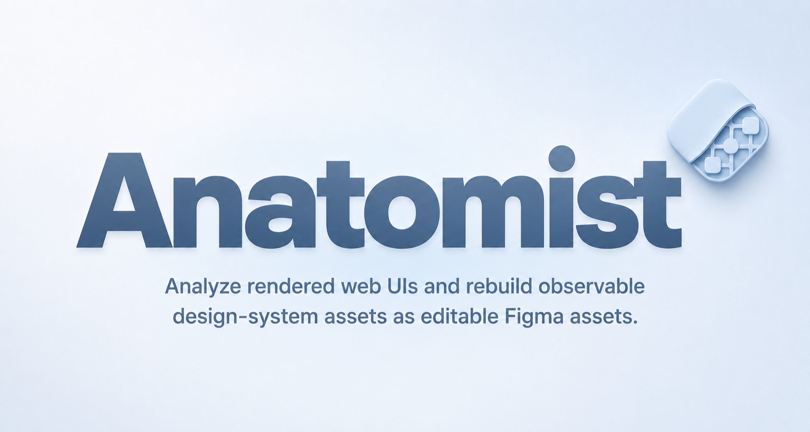

English | [简体中文](README.zh-CN.md)

  

# UI-Anatomist

**Public Beta**

Analyze rendered web UIs and rebuild observable design-system assets as editable Figma assets.

[Product overview](#product-overview) · [Download Public Beta](https://github.com/SuJiaYi27/UI-Anatomist/releases/latest) · [Installation](docs/installation.md) · [Privacy & safety](docs/privacy-and-safety.md)

## Product overview

UI-Anatomist is a two-part workflow for studying and rebuilding the design-system evidence available in a rendered web interface.

| Chrome extension | Figma plugin |
| --- | --- |
| Scans observable styles, controls, states, safe UI icons, and evidence-backed interface structures. It exports the result as structured JSON. | Imports the JSON and creates editable variables, styles, components, component states, icons, and reference boards in Figma. |

The project does not claim to recover a website's private source code, original design files, hidden states, or complete internal design system.

## Contents

- [Showcase](#showcase)
- [Core capabilities](#core-capabilities)
- [Known limitations](#known-limitations)
- [Quick start](#quick-start)
- [Privacy & safety](#privacy--safety)
- [Documentation](#documentation)
- [Community & contributions](#community--contributions)
- [Roadmap](#roadmap)
- [Development](#development)
- [License](#license)

## Showcase

An approved 56-second end-to-end Chrome scan and Figma import demonstration will be attached here during GitHub publication. The JSON shown in the recording is blurred, and the underlying scan JSON is not published.

> **Showcase note:** The OpenAI Help Center is shown only as a demonstration target. OpenAI products also supported the design and development process, and I am grateful for the tools that helped make this project possible. UI-Anatomist is an independent open-source project. This project is not affiliated with, sponsored by, or endorsed by OpenAI or Figma.

## Core capabilities

1. **Evidence-based scanning** — works from design evidence already rendered in the browser instead of inventing unavailable source information.
2. **Editable Figma output** — creates native, editable Figma variables, styles, components, icons, and reference boards.
3. **Foundational design assets** — extracts typography, colors, border radii, shadows, and spacing supported by observed evidence.
4. **Controls and observed states** — identifies supported controls and the states actually observed during a bounded scan.
5. **Safe UI icons and reusable structures** — preserves eligible interface icons and composite structures only when ownership, geometry, and reference checks pass.
6. **Repeatable imports** — uses stable ownership and validation rules to update matching assets, report conflicts, and avoid uncontrolled duplication.

Coverage varies across websites. Complex, dynamic, or highly customized interfaces may be only partially represented.

## Known limitations

This Public Beta is still improving its coverage of custom and complex interface structures:

- Control labels with multiple lines or unusual text layouts may be grouped incorrectly.
- Icon ownership may be incomplete when an interface uses unusual icon containers or several graphics within the same control.
- Non-standard control shells, nested interactions, and relationships between interface elements may be identified incorrectly.
- Custom menus without standard semantic information may be missed.

These limitations describe possible user-visible results, not fixed implementation rules. Please report sanitized examples through Issues and do not attach private JSON or unreviewed screenshots.

## Quick start

1. Download the latest combined Public Beta package.
2. Install the unpacked Chrome extension from the package's `chrome/` directory.
3. Open an authorized website, run the scan, and copy or download the generated JSON.
4. Import the Figma development plugin from `figma/manifest.json` in Figma Desktop.
5. Paste the JSON into the Figma plugin and select **Import JSON**.

No OpenAI, Codex, or other external AI API key is required for this workflow.

See the [installation guide](docs/installation.md) for complete steps and troubleshooting.

## Privacy & safety

- Website access is requested for the current site when the user starts a scan.
- Scan results stay in Chrome's in-memory session storage unless the user copies or downloads them.
- The project has no developer-operated backend, telemetry service, or external AI API dependency.
- The Figma plugin declares no external network access.
- The Chrome scanner may request cross-origin page-linked stylesheets without credentials for hover inspection, and may re-read page-referenced same-origin font or SVG sprite resources under the website's normal same-origin session. These resources are processed locally and are not sent to a project backend.
- Input values, account context, long-form content, brand assets, and unsafe actions are subject to filtering and blocking rules. Some short interface labels may be included after safety checks.
- Automated filtering is not a substitute for human review. Inspect every JSON file before sharing it publicly.

Use the project only on websites and materials you own or are authorized to analyze. See [Privacy & Safety](docs/privacy-and-safety.md) and [Security Policy](SECURITY.md).

## Documentation

- [Installation](docs/installation.md)
- [Privacy & Safety](docs/privacy-and-safety.md)
- [Understanding scan output](docs/scan-output.md)
- [Roadmap](docs/roadmap.md)
- [Development](docs/development.md)

## Community & contributions

This is my first public release of a project I have built from the ground up. Websites express interface structures and design systems in many different ways, so improving general coverage requires careful testing and iteration. I sincerely welcome usage feedback, bug reports, feature ideas, technical discussion, and code contributions. I hope the project can grow from its first public version into a practical tool that brings lasting value to designers.

- Report bugs or request features through [Issues](https://github.com/SuJiaYi27/UI-Anatomist/issues).
- Ask questions or share ideas in [Discussions](https://github.com/SuJiaYi27/UI-Anatomist/discussions).
- Read [CONTRIBUTING.md](CONTRIBUTING.md) before submitting a pull request.
- Report security vulnerabilities privately according to [SECURITY.md](SECURITY.md).
- Participation is governed by [CODE_OF_CONDUCT.md](CODE_OF_CONDUCT.md).

Opening an issue or pull request does not guarantee a fixed response time, implementation, acceptance, or merge.

## Roadmap

The next phase will focus on component coverage and reconstruction accuracy:

- Expand coverage of common controls and evidence-backed composite components.
- Improve relationships among states, icons, controls, menus, lists, and popovers.
- Improve stability on dynamic and deeply nested interfaces.
- Keep repeated imports predictable and reviewable.
- Continue anonymous automated testing and authorized real-site acceptance checks.

The next beta update will be released after the planned component-coverage improvements pass safety, quality, and acceptance checks. No fixed release date is promised.

The roadmap does not promise support for every website, every component, or complete recovery of an internal design system.

## Development

The repository includes the Chrome extension, Figma plugin, shared Schema, build scripts, and anonymized automated tests. See [Development](docs/development.md) for the verified commands and project structure.

## License

Copyright 2026 Su JiaYi.

Licensed under the [Apache License 2.0](LICENSE). Third-party components remain subject to their respective licenses; see [THIRD_PARTY_NOTICES.md](THIRD_PARTY_NOTICES.md). Project names and logos are not granted under the Apache License 2.0.
