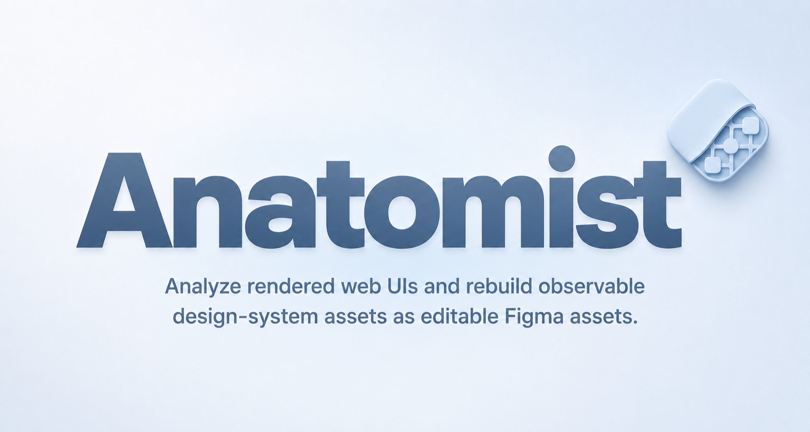

[English](README.md) | 简体中文

  

# UI-Anatomist

**公开测试版（Public Beta）**

分析已经渲染出来的网页界面，并把其中能够观察到的设计系统素材，重建为可编辑的 Figma 素材。

[产品介绍](#产品概述) · [下载公开测试版](https://github.com/SuJiaYi27/UI-Anatomist/releases/latest) · [安装说明](docs/installation.md) · [隐私与安全](docs/privacy-and-safety.md)

## 产品概述

UI-Anatomist 是一个从网页到 Figma 的设计系统分析工具，由 Chrome 插件和 Figma 插件共同组成。

| Chrome 插件 | Figma 插件 |
| --- | --- |
| 扫描网页中能够观察到的样式、控件、控件状态、安全的界面图标，以及具有明确证据的界面结构，并生成结构化 JSON。 | 读入 JSON，在 Figma 中生成可编辑的变量、样式、组件、组件状态、图标和参考画板。 |

UI-Anatomist 只处理网页中实际呈现、能够观察到的设计证据。

它不会声称能够恢复网站的私有源代码、原始设计文件、没有出现过的隐藏状态，或者网站内部完整的设计系统。

## 目录

- [产品展示](#产品展示)
- [核心功能](#核心功能)
- [已知限制](#已知限制)
- [快速开始](#快速开始)
- [隐私与安全](#隐私与安全)
- [文档](#文档)
- [社区与贡献](#社区与贡献)
- [下一阶段计划](#下一阶段计划)
- [开发说明](#开发说明)
- [开源许可证](#开源许可证)

## 产品展示

这里会在 GitHub 正式发布时放入已经确认的 56 秒实际演示视频，完整展示从 Chrome 扫描到 Figma 导入的流程。视频中出现的 JSON 已经打码，底层的真实扫描 JSON 不会公开。

> **展示说明：** OpenAI Help Center 仅作为实际演示对象。OpenAI 的产品也参与并帮助了这个项目的设计与开发过程，我非常感谢这些工具为项目提供的帮助。UI-Anatomist 是一个独立的开源项目，与 OpenAI 或 Figma 不存在合作、赞助或背书关系。

## 核心功能

### 1. 基于真实证据进行扫描

从浏览器已经渲染出来的界面中读取设计证据，不猜测网页没有展示出来的信息，也不凭空补充状态。

### 2. 生成可编辑的 Figma 素材

生成原生、可继续编辑的 Figma 变量、样式、组件、图标和参考画板，而不是只生成截图或不可修改的静态结果。

### 3. 分析基础设计素材

分析网页中能够观察到的字体与文字样式、颜色、圆角、阴影和间距。只有具备实际观察证据的内容才会进入结果。

### 4. 识别控件及其状态

识别支持范围内的按钮、输入框、选择器等控件，以及扫描过程中真实观察到的控件状态。不会为了让组件看起来完整而虚构没有观察到的状态。

### 5. 保留安全的界面图标与复合结构

当图标归属、几何关系和引用关系通过检查时，保留符合要求的界面图标。对于菜单、列表、弹层等结构，只有在具有足够设计证据时，才会把它们整理为可复用结构。

### 6. 支持重复导入

使用稳定的归属和验证规则更新相同资产、报告冲突，并尽量避免重复导入后产生失控的重复组件。

不同网站的结构差异很大。复杂、动态或高度定制的界面，可能只能识别其中一部分内容。

## 已知限制

当前公开测试版仍在继续提升复杂控件和界面结构的识别范围。

目前可能出现：

- 多行文案或特殊文字排版的控件，文字归并不够准确。
- 图标使用特殊承载结构，或者一个控件中同时存在多个图形时，图标归属可能不完整。
- 非常规控件外壳、嵌套交互和元素之间的归属关系可能识别不准。
- 缺少标准语义信息的自定义菜单可能被漏掉。

这些是用户可能看到的实际表现，不代表产品内部使用固定规则限制这些结构。

如果提交问题，请先删除私人信息，不要公开上传私人 JSON 或未经检查的截图。

## 快速开始

1. 下载最新的 Chrome + Figma 公开测试版联合安装包。
2. 从安装包的 `chrome/` 文件夹加载 Chrome 插件。
3. 打开你拥有或获得授权的网站，运行扫描。
4. 复制或下载插件生成的 JSON。
5. 在 Figma Desktop 中，从 `figma/manifest.json` 导入 Figma 开发插件。
6. 将 JSON 粘贴进 Figma 插件。
7. 点击 **Import JSON**。

这套流程不需要 OpenAI、Codex 或其他外部 AI 服务的 API Key。

完整步骤和常见问题见[安装说明](docs/installation.md)。

## 隐私与安全

- 只有用户主动开始扫描时，Chrome 才会申请访问当前网站。
- 用户复制或下载之前，扫描结果保存在 Chrome 当前会话的内存存储中。
- 项目没有开发者运营的后端服务器。
- 项目不包含遥测或用户行为统计服务。
- 项目不依赖外部 AI API。
- Figma 插件不允许访问外部网络。
- Chrome 扫描器可能会在不携带凭据的情况下请求页面引用的跨域样式表，以检查 hover 状态；也可能在网站正常的同源会话下重新读取页面引用的同源字体或 SVG 集合。这些资源只在本地处理，不会发送到项目后端。
- 输入内容、账号信息、长篇正文、品牌素材和危险操作会受到过滤或阻止。部分通过安全检查的短界面文案可能进入扫描结果。
- 自动过滤不能代替人工检查，公开分享 JSON 前必须由用户再次检查。

只能将本项目用于你拥有或已经获得授权的网站和素材。更完整的权限、数据流、网络行为和安全边界见[隐私与安全](docs/privacy-and-safety.md)和[安全政策](SECURITY.md)。

## 文档

- [安装说明](docs/installation.md)
- [隐私与安全](docs/privacy-and-safety.md)
- [如何理解扫描结果](docs/scan-output.md)
- [下一阶段计划](docs/roadmap.md)
- [开发说明](docs/development.md)

## 社区与贡献

这是我第一次公开发布一个从零到一完成的项目。

不同网站表达界面结构和设计系统的方式差异很大，因此提升通用识别能力需要持续测试和迭代，也需要一定周期。

我真诚欢迎大家分享使用反馈、提交问题、提出功能想法、参与技术讨论和提交代码改进。我希望 UI-Anatomist 能够从第一个公开版本开始，逐步成长为真正能够为设计师带来长期价值的工具。

- 使用 [Issues](https://github.com/SuJiaYi27/UI-Anatomist/issues) 报告问题或提出功能需求。
- 使用 [Discussions](https://github.com/SuJiaYi27/UI-Anatomist/discussions) 讨论问题和分享想法。
- 提交代码前请阅读 [CONTRIBUTING.md](CONTRIBUTING.md)。
- 安全问题请根据 [SECURITY.md](SECURITY.md) 私密报告。
- 社区参与需要遵守 [CODE_OF_CONDUCT.md](CODE_OF_CONDUCT.md)。

提交 Issue 或代码并不代表一定会在固定时间内得到处理、采用或合并。

## 下一阶段计划

公开测试版发布后的下一阶段，重点提升组件覆盖范围和重建准确度。

主要方向包括：

- 扩大常见控件和具有明确证据的复合组件的识别范围。
- 改善状态、图标、控件、菜单、列表和弹层之间的关系。
- 提升动态界面和深层嵌套结构中的稳定性。
- 让重复导入的更新结果更加稳定、清楚和便于检查。
- 继续使用匿名自动测试和经过授权的真实网站验收。

下一次公开测试版更新将在计划中的组件覆盖改进通过安全、质量和验收检查后发布，目前不承诺固定发布日期。

这份计划不承诺支持所有网站、所有组件，也不承诺完整恢复网站内部的设计系统。

## 开发说明

仓库包含 Chrome 插件源码、Figma 插件源码、Chrome 与 Figma 共用的 JSON Schema、可复现构建脚本和匿名自动测试。项目结构、依赖安装、测试和构建方法见[开发说明](docs/development.md)。

## 开源许可证

Copyright 2026 Su JiaYi.

项目使用 [Apache License 2.0](LICENSE) 开源。第三方依赖仍然遵循各自的许可证，具体信息见 [THIRD_PARTY_NOTICES.md](THIRD_PARTY_NOTICES.md)。Apache License 2.0 不自动授予其他人使用 UI-Anatomist 产品名称和 Logo 的权利。
